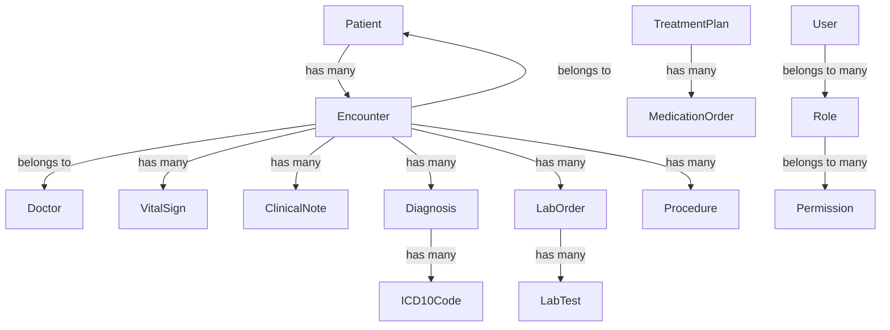

# EMR Database Schema Design

## Overview

This document outlines the comprehensive database schema design for the Electronic Medical Records (EMR) system, building upon the existing clinic management system.

## Current Structure Analysis

### Existing Tables

- **Users**: Core user management
- **Patients**: Basic patient information with medical history
- **Doctors**: Healthcare provider information
- **Appointments**: Scheduling and visit management
- **MedicalRecords**: General medical record storage
- **Bills**: Financial transactions
- **Clinics**: Clinic information

### Key Relationships

- Patient ↔ Appointment (1:N)
- Appointment ↔ MedicalRecord (1:N)
- Patient ↔ MedicalRecord (1:N)
- Doctor ↔ Appointment (1:N)

## EMR Schema Design

### 1. Patient Master Enhancement

#### `patients` table (enhanced)

```php
Schema::table('patients', function (Blueprint $table) {
    // Existing fields
    $table->string('emergency_contact_name')->nullable();
    $table->string('emergency_contact_phone')->nullable();
    $table->string('blood_type')->nullable();
    $table->string('allergies')->nullable();
    $table->text('medical_history')->nullable();

    // New fields for comprehensive patient master
    $table->date('date_of_birth')->nullable();
    $table->string('gender')->nullable();
    $table->string('marital_status')->nullable();
    $table->string('occupation')->nullable();
    $table->string('national_id')->nullable();
    $table->string('preferred_language')->nullable();
    $table->json('contact_preferences')->nullable(); // Email, SMS, Phone preferences
    $table->json('family_medical_history')->nullable();
    $table->json('social_history')->nullable(); // Smoking, alcohol, etc.
    $table->json('lifestyle_factors')->nullable(); // Diet, exercise, etc.
});
```

### 2. Visit & Encounter Management

#### `encounters` table (new)

```php
Schema::create('encounters', function (Blueprint $table) {
    $table->id();
    $table->foreignId('clinic_id')->constrained()->onDelete('cascade');
    $table->foreignId('patient_id')->constrained()->onDelete('cascade');
    $table->foreignId('appointment_id')->nullable()->constrained()->onDelete('set null');
    $table->foreignId('doctor_id')->constrained()->onDelete('cascade');
    $table->foreignId('created_by')->constrained('users')->onDelete('set null');

    $table->string('encounter_type'); // In-person, Telemedicine, Home visit
    $table->string('encounter_number')->unique();
    $table->dateTime('start_time');
    $table->dateTime('end_time')->nullable();
    $table->string('status')->default('active'); // active, completed, cancelled
    $table->string('priority')->default('normal'); // routine, urgent, emergency
    $table->text('chief_complaint')->nullable();
    $table->text('history_of_present_illness')->nullable();

    $table->timestamps();
    $table->softDeletes();
});
```

### 3. Vitals Signs Management

#### `vital_signs` table (new)

```php
Schema::create('vital_signs', function (Blueprint $table) {
    $table->id();
    $table->foreignId('encounter_id')->constrained()->onDelete('cascade');
    $table->foreignId('patient_id')->constrained()->onDelete('cascade');
    $table->foreignId('recorded_by')->constrained('users')->onDelete('set null');

    $table->decimal('height', 5, 2)->nullable(); // cm
    $table->decimal('weight', 5, 2)->nullable(); // kg
    $table->decimal('bmi', 5, 2)->nullable(); // calculated
    $table->decimal('temperature', 4, 1)->nullable(); // °C
    $table->integer('systolic_bp')->nullable(); // mmHg
    $table->integer('diastolic_bp')->nullable(); // mmHg
    $table->integer('pulse_rate')->nullable(); // bpm
    $table->integer('respiratory_rate')->nullable(); // breaths/min
    $table->decimal('oxygen_saturation', 4, 1)->nullable(); // %
    $table->text('notes')->nullable();

    $table->timestamps();
    $table->softDeletes();
});
```

### 4. Clinical Notes

#### `clinical_notes` table (new)

```php
Schema::create('clinical_notes', function (Blueprint $table) {
    $table->id();
    $table->foreignId('encounter_id')->constrained()->onDelete('cascade');
    $table->foreignId('patient_id')->constrained()->onDelete('cascade');
    $table->foreignId('doctor_id')->constrained()->onDelete('cascade');
    $table->foreignId('created_by')->constrained('users')->onDelete('set null');

    $table->string('note_type'); // SOAP, Progress, Discharge, etc.
    $table->text('subjective')->nullable(); // Patient's perspective
    $table->text('objective')->nullable(); // Clinical findings
    $table->text('assessment')->nullable(); // Clinical judgment
    $table->text('plan')->nullable(); // Treatment plan
    $table->text('clinical_impression')->nullable();
    $table->boolean('is_confidential')->default(false);

    $table->timestamps();
    $table->softDeletes();
});
```

### 5. Diagnosis Management

#### `diagnoses` table (new)

```php
Schema::create('diagnoses', function (Blueprint $table) {
    $table->id();
    $table->foreignId('encounter_id')->constrained()->onDelete('cascade');
    $table->foreignId('patient_id')->constrained()->onDelete('cascade');
    $table->foreignId('doctor_id')->constrained()->onDelete('cascade');
    $table->foreignId('created_by')->constrained('users')->onDelete('set null');

    $table->string('diagnosis_type'); // Primary, Secondary, Differential
    $table->text('clinical_description')->nullable();
    $table->date('date_of_diagnosis');
    $table->string('diagnosis_status')->default('active'); // active, resolved, chronic
    $table->text('supporting_evidence')->nullable();
    $table->boolean('is_confirmed')->default(false);

    $table->timestamps();
    $table->softDeletes();
});
```

### 6. ICD-10 Coding

#### `icd10_codes` table (new)

```php
Schema::create('icd10_codes', function (Blueprint $table) {
    $table->id();
    $table->string('code')->unique(); // ICD-10 code
    $table->text('description'); // Full description
    $table->string('category')->nullable();
    $table->string('chapter')->nullable();
    $table->boolean('is_active')->default(true);

    $table->timestamps();
});
```

#### `diagnosis_icd10` pivot table (new)

```php
Schema::create('diagnosis_icd10', function (Blueprint $table) {
    $table->id();
    $table->foreignId('diagnosis_id')->constrained()->onDelete('cascade');
    $table->foreignId('icd10_code_id')->constrained()->onDelete('cascade');
    $table->string('code_type')->default('primary'); // primary, secondary, additional

    $table->timestamps();
});
```

### 7. Lab & Investigation Management

#### `lab_orders` table (new)

```php
Schema::create('lab_orders', function (Blueprint $table) {
    $table->id();
    $table->foreignId('encounter_id')->constrained()->onDelete('cascade');
    $table->foreignId('patient_id')->constrained()->onDelete('cascade');
    $table->foreignId('doctor_id')->constrained()->onDelete('cascade');
    $table->foreignId('ordered_by')->constrained('users')->onDelete('set null');

    $table->string('order_number')->unique();
    $table->string('priority')->default('routine'); // routine, urgent, stat
    $table->string('status')->default('ordered'); // ordered, processing, completed, cancelled
    $table->text('clinical_indication')->nullable();
    $table->dateTime('specimen_collection_time')->nullable();
    $table->dateTime('results_available_time')->nullable();

    $table->timestamps();
    $table->softDeletes();
});
```

#### `lab_tests` table (new)

```php
Schema::create('lab_tests', function (Blueprint $table) {
    $table->id();
    $table->foreignId('lab_order_id')->constrained()->onDelete('cascade');
    $table->foreignId('test_catalog_id')->constrained()->onDelete('cascade');

    $table->string('status')->default('pending'); // pending, processing, completed, cancelled
    $table->text('specimen_type')->nullable();
    $table->text('specimen_source')->nullable();
    $table->text('results')->nullable();
    $table->text('reference_range')->nullable();
    $table->text('interpretation')->nullable();
    $table->text('comments')->nullable();
    $table->foreignId('processed_by')->nullable()->constrained('users')->onDelete('set null');

    $table->timestamps();
    $table->softDeletes();
});
```

#### `test_catalog` table (new)

```php
Schema::create('test_catalog', function (Blueprint $table) {
    $table->id();
    $table->string('test_code')->unique();
    $table->string('test_name');
    $table->text('description')->nullable();
    $table->string('category'); // Hematology, Biochemistry, Microbiology, etc.
    $table->string('specimen_type');
    $table->text('reference_range')->nullable();
    $table->string('unit_of_measure')->nullable();
    $table->decimal('turnaround_time', 5, 2)->nullable(); // hours
    $table->boolean('is_active')->default(true);

    $table->timestamps();
});
```

### 8. Treatment Plan & Medications

#### `treatment_plans` table (new)

```php
Schema::create('treatment_plans', function (Blueprint $table) {
    $table->id();
    $table->foreignId('encounter_id')->constrained()->onDelete('cascade');
    $table->foreignId('patient_id')->constrained()->onDelete('cascade');
    $table->foreignId('doctor_id')->constrained()->onDelete('cascade');
    $table->foreignId('created_by')->constrained('users')->onDelete('set null');

    $table->string('plan_type'); // Acute, Chronic, Preventive, Rehabilitation
    $table->date('start_date');
    $table->date('end_date')->nullable();
    $table->text('goals')->nullable();
    $table->text('instructions')->nullable();
    $table->string('status')->default('active'); // active, completed, discontinued

    $table->timestamps();
    $table->softDeletes();
});
```

#### `medication_orders` table (new)

```php
Schema::create('medication_orders', function (Blueprint $table) {
    $table->id();
    $table->foreignId('treatment_plan_id')->constrained()->onDelete('cascade');
    $table->foreignId('patient_id')->constrained()->onDelete('cascade');
    $table->foreignId('doctor_id')->constrained()->onDelete('cascade');
    $table->foreignId('prescribed_by')->constrained('users')->onDelete('set null');

    $table->foreignId('medication_id')->constrained()->onDelete('cascade');
    $table->string('dosage')->nullable();
    $table->string('frequency')->nullable();
    $table->string('route')->nullable(); // Oral, IV, IM, etc.
    $table->string('duration')->nullable();
    $table->text('instructions')->nullable();
    $table->integer('quantity')->nullable();
    $table->integer('refills')->default(0);
    $table->string('status')->default('active'); // active, completed, discontinued
    $table->dateTime('start_date')->nullable();
    $table->dateTime('end_date')->nullable();

    $table->timestamps();
    $table->softDeletes();
});
```

#### `medications` table (new)

```php
Schema::create('medications', function (Blueprint $table) {
    $table->id();
    $table->string('generic_name');
    $table->string('brand_name')->nullable();
    $table->string('drug_code')->unique();
    $table->text('description')->nullable();
    $table->string('drug_class')->nullable();
    $table->string('form')->nullable(); // Tablet, Capsule, Injection, etc.
    $table->string('strength')->nullable();
    $table->text('indications')->nullable();
    $table->text('contraindications')->nullable();
    $table->text('side_effects')->nullable();
    $table->boolean('is_controlled')->default(false);
    $table->boolean('requires_prescription')->default(true);

    $table->timestamps();
});
```

### 9. Clinical Decision Support

#### `clinical_rules` table (new)

```php
Schema::create('clinical_rules', function (Blueprint $table) {
    $table->id();
    $table->string('rule_name')->unique();
    $table->text('description');
    $table->string('rule_type'); // Alert, Reminder, Guideline, Protocol
    $table->string('severity')->default('medium'); // low, medium, high, critical
    $table->json('conditions')->nullable(); // JSON conditions for rule triggering
    $table->json('actions')->nullable(); // JSON actions to take
    $table->boolean('is_active')->default(true);
    $table->string('category')->nullable(); // Medication, Diagnosis, Lab, etc.

    $table->timestamps();
});
```

#### `clinical_rule_triggers` table (new)

```php
Schema::create('clinical_rule_triggers', function (Blueprint $table) {
    $table->id();
    $table->foreignId('rule_id')->constrained()->onDelete('cascade');
    $table->foreignId('patient_id')->constrained()->onDelete('cascade');
    $table->foreignId('encounter_id')->nullable()->constrained()->onDelete('set null');
    $table->foreignId('triggered_by')->nullable()->constrained('users')->onDelete('set null');

    $table->string('status')->default('pending'); // pending, acknowledged, dismissed
    $table->text('context')->nullable(); // Additional context
    $table->dateTime('acknowledged_at')->nullable();
    $table->foreignId('acknowledged_by')->nullable()->constrained('users')->onDelete('set null');

    $table->timestamps();
});
```

### 10. Procedures & Interventions

#### `procedures` table (new)

```php
Schema::create('procedures', function (Blueprint $table) {
    $table->id();
    $table->foreignId('encounter_id')->constrained()->onDelete('cascade');
    $table->foreignId('patient_id')->constrained()->onDelete('cascade');
    $table->foreignId('doctor_id')->constrained()->onDelete('cascade');
    $table->foreignId('performed_by')->nullable()->constrained('users')->onDelete('set null');

    $table->foreignId('procedure_catalog_id')->constrained()->onDelete('cascade');
    $table->dateTime('scheduled_time')->nullable();
    $table->dateTime('start_time')->nullable();
    $table->dateTime('end_time')->nullable();
    $table->string('status')->default('scheduled'); // scheduled, in-progress, completed, cancelled
    $table->text('indication')->nullable();
    $table->text('findings')->nullable();
    $table->text('complications')->nullable();
    $table->text('follow_up_instructions')->nullable();

    $table->timestamps();
    $table->softDeletes();
});
```

#### `procedure_catalog` table (new)

```php
Schema::create('procedure_catalog', function (Blueprint $table) {
    $table->id();
    $table->string('procedure_code')->unique();
    $table->string('procedure_name');
    $table->text('description')->nullable();
    $table->string('category')->nullable(); // Surgical, Diagnostic, Therapeutic
    $table->string('specialty')->nullable();
    $table->decimal('estimated_duration', 5, 2)->nullable(); // minutes
    $table->text('preparation_instructions')->nullable();
    $table->text('post_procedure_instructions')->nullable();
    $table->boolean('requires_consent')->default(false);
    $table->boolean('is_active')->default(true);

    $table->timestamps();
});
```

### 11. Document & File Management

#### `documents` table (new)

```php
Schema::create('documents', function (Blueprint $table) {
    $table->id();
    $table->foreignId('patient_id')->constrained()->onDelete('cascade');
    $table->foreignId('uploaded_by')->constrained('users')->onDelete('set null');

    $table->string('document_type'); // Medical Record, Consent Form, Insurance, ID, Other
    $table->string('title');
    $table->text('description')->nullable();
    $table->string('file_path');
    $table->string('file_type');
    $table->string('file_size')->nullable();
    $table->string('file_hash')->nullable(); // For integrity verification
    $table->boolean('is_confidential')->default(false);
    $table->boolean('is_signed')->default(false);
    $table->dateTime('document_date')->nullable();
    $table->dateTime('expiry_date')->nullable();

    $table->timestamps();
    $table->softDeletes();
});
```

#### `document_versions` table (new)

```php
Schema::create('document_versions', function (Blueprint $table) {
    $table->id();
    $table->foreignId('document_id')->constrained()->onDelete('cascade');
    $table->foreignId('versioned_by')->constrained('users')->onDelete('set null');

    $table->string('version_number');
    $table->string('file_path');
    $table->text('change_description')->nullable();
    $table->boolean('is_current')->default(false);

    $table->timestamps();
});
```

### 12. Dashboard & Analytics

#### `clinical_metrics` table (new)

```php
Schema::create('clinical_metrics', function (Blueprint $table) {
    $table->id();
    $table->string('metric_name')->unique();
    $table->text('description')->nullable();
    $table->string('category'); // Quality, Safety, Efficiency, Patient Experience
    $table->string('calculation_method')->nullable();
    $table->string('frequency')->default('monthly'); // daily, weekly, monthly, quarterly
    $table->boolean('is_active')->default(true);

    $table->timestamps();
});
```

#### `metric_values` table (new)

```php
Schema::create('metric_values', function (Blueprint $table) {
    $table->id();
    $table->foreignId('metric_id')->constrained()->onDelete('cascade');
    $table->foreignId('clinic_id')->constrained()->onDelete('cascade');

    $table->date('period_start_date');
    $table->date('period_end_date');
    $table->decimal('value', 12, 4)->nullable();
    $table->decimal('target', 12, 4)->nullable();
    $table->text('notes')->nullable();

    $table->timestamps();
});
```

### 13. Role-Based Access Control

#### `roles` table (new)

```php
Schema::create('roles', function (Blueprint $table) {
    $table->id();
    $table->string('name')->unique();
    $table->string('display_name');
    $table->text('description')->nullable();
    $table->boolean('is_active')->default(true);

    $table->timestamps();
});
```

#### `permissions` table (new)

```php
Schema::create('permissions', function (Blueprint $table) {
    $table->id();
    $table->string('name')->unique();
    $table->string('display_name');
    $table->text('description')->nullable();
    $table->string('category')->nullable(); // Patient, Clinical, Admin, etc.
    $table->boolean('is_active')->default(true);

    $table->timestamps();
});
```

#### `role_permission` pivot table (new)

```php
Schema::create('role_permission', function (Blueprint $table) {
    $table->id();
    $table->foreignId('role_id')->constrained()->onDelete('cascade');
    $table->foreignId('permission_id')->constrained()->onDelete('cascade');

    $table->timestamps();
});
```

#### `user_role` pivot table (new)

```php
Schema::create('user_role', function (Blueprint $table) {
    $table->id();
    $table->foreignId('user_id')->constrained()->onDelete('cascade');
    $table->foreignId('role_id')->constrained()->onDelete('cascade');

    $table->timestamps();
});
```

### 14. Data Security & Compliance

#### `audit_logs` table (enhanced)

```php
Schema::table('audit_logs', function (Blueprint $table) {
    // Existing fields
    $table->foreignId('user_id')->nullable()->constrained()->onDelete('set null');
    $table->string('action');
    $table->string('model_type');
    $table->string('model_id');
    $table->json('old_values')->nullable();
    $table->json('new_values')->nullable();
    $table->string('ip_address')->nullable();
    $table->string('user_agent')->nullable();

    // New fields for enhanced compliance
    $table->string('compliance_category')->nullable(); // HIPAA, GDPR, etc.
    $table->boolean('is_sensitive')->default(false);
    $table->string('data_classification')->nullable(); // PII, PHI, Confidential
});
```

#### `consent_forms` table (new)

```php
Schema::create('consent_forms', function (Blueprint $table) {
    $table->id();
    $table->foreignId('patient_id')->constrained()->onDelete('cascade');
    $table->foreignId('document_id')->constrained()->onDelete('cascade');
    $table->foreignId('created_by')->constrained('users')->onDelete('set null');

    $table->string('consent_type'); // Treatment, Privacy, Research, etc.
    $table->text('description')->nullable();
    $table->string('status')->default('pending'); // pending, signed, declined, expired
    $table->dateTime('signed_at')->nullable();
    $table->foreignId('signed_by')->nullable()->constrained('users')->onDelete('set null');
    $table->string('signature_method')->nullable(); // Electronic, Paper, Witnessed
    $table->dateTime('valid_from')->nullable();
    $table->dateTime('valid_until')->nullable();
    $table->text('witness_details')->nullable();

    $table->timestamps();
    $table->softDeletes();
});
```

#### `data_access_logs` table (new)

```php
Schema::create('data_access_logs', function (Blueprint $table) {
    $table->id();
    $table->foreignId('user_id')->constrained()->onDelete('cascade');
    $table->foreignId('patient_id')->constrained()->onDelete('cascade');
    $table->string('access_type'); // View, Create, Update, Delete, Export
    $table->string('model_type')->nullable();
    $table->string('model_id')->nullable();
    $table->string('purpose_of_access')->nullable();
    $table->string('ip_address')->nullable();
    $table->string('device_info')->nullable();
    $table->string('location')->nullable();
    $table->boolean('is_authorized')->default(true);

    $table->timestamps();
});
```

### 15. Interoperability

#### `integration_logs` table (new)

```php
Schema::create('integration_logs', function (Blueprint $table) {
    $table->id();
    $table->string('integration_type'); // HL7, FHIR, API, etc.
    $table->string('direction'); // Inbound, Outbound
    $table->string('endpoint')->nullable();
    $table->string('message_type')->nullable();
    $table->text('payload')->nullable();
    $table->string('status')->default('pending'); // pending, success, failed, retry
    $table->text('response')->nullable();
    $table->integer('attempts')->default(1);
    $table->foreignId('patient_id')->nullable()->constrained()->onDelete('set null');
    $table->foreignId('created_by')->nullable()->constrained('users')->onDelete('set null');

    $table->timestamps();
});
```

#### `external_systems` table (new)

```php
Schema::create('external_systems', function (Blueprint $table) {
    $table->id();
    $table->string('system_name')->unique();
    $table->string('system_type'); // EHR, LIS, RIS, PACS, etc.
    $table->text('description')->nullable();
    $table->string('api_endpoint')->nullable();
    $table->string('authentication_method')->nullable();
    $table->json('configuration')->nullable();
    $table->boolean('is_active')->default(true);
    $table->dateTime('last_sync')->nullable();

    $table->timestamps();
});
```

### 16. AI-Assisted Features

#### `ai_analysis_requests` table (new)

```php
Schema::create('ai_analysis_requests', function (Blueprint $table) {
    $table->id();
    $table->foreignId('patient_id')->constrained()->onDelete('cascade');
    $table->foreignId('encounter_id')->nullable()->constrained()->onDelete('set null');
    $table->foreignId('requested_by')->constrained('users')->onDelete('set null');

    $table->string('analysis_type'); // Diagnosis, Treatment, Risk, etc.
    $table->json('input_data')->nullable();
    $table->string('status')->default('queued'); // queued, processing, completed, failed
    $table->json('results')->nullable();
    $table->text('confidence_score')->nullable();
    $table->text('explanation')->nullable();
    $table->dateTime('processed_at')->nullable();

    $table->timestamps();
});
```

#### `ai_model_versions` table (new)

```php
Schema::create('ai_model_versions', function (Blueprint $table) {
    $table->id();
    $table->string('model_name');
    $table->string('version')->unique();
    $table->text('description')->nullable();
    $table->string('purpose'); // Diagnosis, Prediction, etc.
    $table->string('status')->default('development'); // development, testing, production, deprecated
    $table->dateTime('trained_at')->nullable();
    $table->text('training_data_summary')->nullable();
    $table->decimal('accuracy', 5, 2)->nullable();
    $table->json('performance_metrics')->nullable();
    $table->boolean('is_active')->default(false);

    $table->timestamps();
});
```

### 17. System Admin Features

#### `system_settings` table (new)

```php
Schema::create('system_settings', function (Blueprint $table) {
    $table->id();
    $table->string('setting_key')->unique();
    $table->text('setting_value');
    $table->string('setting_type'); // System, Clinical, Security, Integration
    $table->text('description')->nullable();
    $table->boolean('is_editable')->default(true);
    $table->boolean('requires_restart')->default(false);

    $table->timestamps();
});
```

#### `maintenance_logs` table (new)

```php
Schema::create('maintenance_logs', function (Blueprint $table) {
    $table->id();
    $table->string('maintenance_type'); // Backup, Update, Migration, etc.
    $table->string('status')->default('started'); // started, completed, failed
    $table->text('description')->nullable();
    $table->dateTime('started_at');
    $table->dateTime('completed_at')->nullable();
    $table->foreignId('performed_by')->nullable()->constrained('users')->onDelete('set null');
    $table->text('results')->nullable();
    $table->text('errors')->nullable();

    $table->timestamps();
});
```

## Model Relationships

### Core Relationships



### Key Relationships

1. **Patient ↔ Encounter**: One-to-Many
2. **Encounter ↔ VitalSigns**: One-to-Many
3. **Encounter ↔ ClinicalNotes**: One-to-Many
4. **Encounter ↔ Diagnoses**: One-to-Many
5. **Diagnosis ↔ ICD10Codes**: Many-to-Many (through diagnosis_icd10)
6. **Encounter ↔ LabOrders**: One-to-Many
7. **LabOrder ↔ LabTests**: One-to-Many
8. **Encounter ↔ TreatmentPlans**: One-to-Many
9. **TreatmentPlan ↔ MedicationOrders**: One-to-Many
10. **Patient ↔ Documents**: One-to-Many
11. **User ↔ Roles**: Many-to-Many (through user_role)
12. **Role ↔ Permissions**: Many-to-Many (through role_permission)

## Implementation Plan

### Phase 1: Core EMR Tables

1. Enhance Patient Master table
2. Create Encounters table
3. Create Vital Signs table
4. Create Clinical Notes table
5. Create Diagnoses table
6. Create ICD-10 Coding tables

### Phase 2: Clinical Workflow Tables

1. Create Lab & Investigation Management tables
2. Create Treatment Plan & Medications tables
3. Create Procedures & Interventions tables
4. Create Clinical Decision Support tables

### Phase 3: Support & Compliance Tables

1. Create Document & File Management tables
2. Create Dashboard & Analytics tables
3. Create Role-Based Access Control tables
4. Create Data Security & Compliance tables

### Phase 4: Advanced Features

1. Create Interoperability tables
2. Create AI-Assisted Features tables
3. Create System Admin Features tables

## Migration Strategy

1. **Backup existing database** before making changes
2. **Create new tables** first to avoid disrupting existing functionality
3. **Enhance existing tables** with new columns using migrations
4. **Add foreign key constraints** after all tables are created
5. **Create indexes** for performance optimization
6. **Seed reference data** (ICD-10 codes, test catalog, etc.)
7. **Update existing models** with new relationships
8. **Create new models** for additional functionality

## Data Security Considerations

1. **Encryption**: Use Laravel's encryption for sensitive fields
2. **Access Control**: Implement RBAC for all EMR data
3. **Audit Logging**: Track all access and modifications
4. **Compliance**: Ensure HIPAA/GDPR compliance features
5. **Data Integrity**: Use database constraints and validations

## Performance Optimization

1. **Indexing**: Add indexes on frequently queried columns
2. **Caching**: Implement caching for reference data
3. **Query Optimization**: Use eager loading for relationships
4. **Database Partitioning**: Consider for large datasets
5. **Read Replicas**: For analytics and reporting

## Next Steps

1. Create migration files for each new table
2. Create Eloquent models with relationships
3. Implement data validation and business logic
4. Create API endpoints for EMR functionality
5. Develop frontend components for EMR features
6. Implement security and compliance features
7. Set up interoperability integrations
8. Develop AI-assisted features
9. Create admin interfaces for system management
