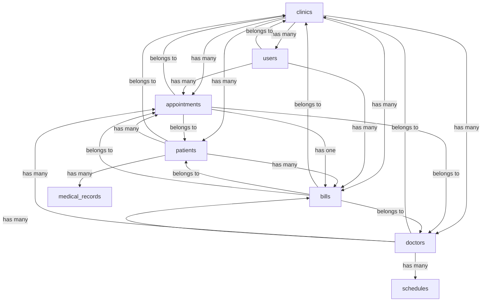
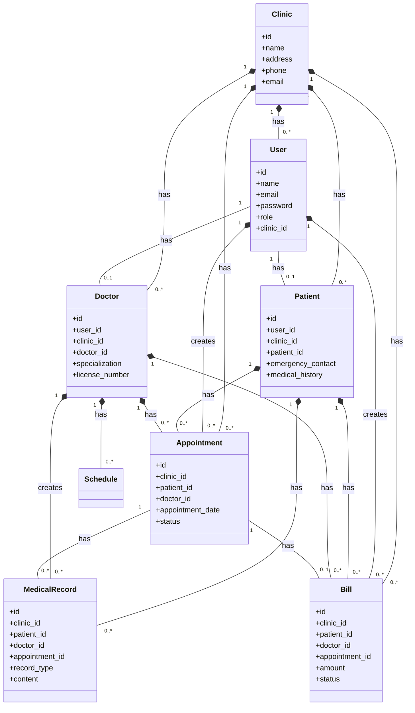

# Medical Clinic Billing and Scheduling System Architecture

## System Overview

This document outlines the core infrastructure design for a multi-clinic medical billing and scheduling system using Laravel and ReactJS with Inertia.js integration.

## Current System Analysis

- **Framework**: Laravel 12.46.0
- **Frontend**: React 19.2.3 with Inertia.js 2.3.7
- **Database**: SQLite (can be migrated to MySQL/PostgreSQL for production)
- **Authentication**: Currently using Laravel Fortify
- **Styling**: Tailwind CSS 4.1.18

## 1. Multi-Clinic Database Schema Design

### Core Tables Structure



### Database Tables Specification

#### 1.1 Clinics Table

```php
Schema::create('clinics', function (Blueprint $table) {
    $table->id();
    $table->string('name');
    $table->string('address');
    $table->string('city');
    $table->string('state');
    $table->string('postal_code');
    $table->string('country');
    $table->string('phone');
    $table->string('email');
    $table->string('website')->nullable();
    $table->text('description')->nullable();
    $table->string('logo_path')->nullable();
    $table->boolean('is_active')->default(true);
    $table->timestamps();
    $table->softDeletes();
});
```

#### 1.2 Users Table (Enhanced)

```php
Schema::table('users', function (Blueprint $table) {
    $table->foreignId('clinic_id')->nullable()->constrained()->onDelete('set null');
    $table->string('role')->default('patient'); // admin, doctor, staff, patient
    $table->string('phone')->nullable();
    $table->string('address')->nullable();
    $table->string('specialization')->nullable(); // For doctors
    $table->string('license_number')->nullable(); // For doctors
    $table->date('date_of_birth')->nullable();
    $table->string('gender')->nullable();
    $table->string('profile_photo_path')->nullable();
});
```

#### 1.3 Patients Table

```php
Schema::create('patients', function (Blueprint $table) {
    $table->id();
    $table->foreignId('clinic_id')->constrained()->onDelete('cascade');
    $table->foreignId('user_id')->constrained()->onDelete('cascade');
    $table->string('patient_id')->unique(); // Custom patient ID
    $table->string('emergency_contact_name')->nullable();
    $table->string('emergency_contact_phone')->nullable();
    $table->string('blood_type')->nullable();
    $table->string('allergies')->nullable();
    $table->text('medical_history')->nullable();
    $table->string('insurance_provider')->nullable();
    $table->string('insurance_policy_number')->nullable();
    $table->date('last_visit_date')->nullable();
    $table->timestamps();
    $table->softDeletes();
});
```

#### 1.4 Doctors Table

```php
Schema::create('doctors', function (Blueprint $table) {
    $table->id();
    $table->foreignId('clinic_id')->constrained()->onDelete('cascade');
    $table->foreignId('user_id')->constrained()->onDelete('cascade');
    $table->string('doctor_id')->unique(); // Custom doctor ID
    $table->string('specialization');
    $table->string('license_number')->unique();
    $table->string('qualifications');
    $table->integer('years_of_experience');
    $table->string('consultation_fee');
    $table->text('bio')->nullable();
    $table->string('availability')->default('Monday-Friday');
    $table->boolean('is_accepting_new_patients')->default(true);
    $table->timestamps();
    $table->softDeletes();
});
```

#### 1.5 Appointments Table

```php
Schema::create('appointments', function (Blueprint $table) {
    $table->id();
    $table->foreignId('clinic_id')->constrained()->onDelete('cascade');
    $table->foreignId('patient_id')->constrained()->onDelete('cascade');
    $table->foreignId('doctor_id')->constrained()->onDelete('cascade');
    $table->foreignId('created_by')->constrained('users')->onDelete('set null');
    $table->string('appointment_number')->unique();
    $table->dateTime('appointment_date');
    $table->dateTime('start_time');
    $table->dateTime('end_time');
    $table->string('status')->default('scheduled'); // scheduled, completed, cancelled, no-show
    $table->string('appointment_type'); // consultation, follow-up, emergency
    $table->text('reason')->nullable();
    $table->text('notes')->nullable();
    $table->string('priority')->default('normal'); // low, normal, high, emergency
    $table->boolean('is_first_visit')->default(false);
    $table->timestamps();
    $table->softDeletes();
});
```

#### 1.6 Bills Table

```php
Schema::create('bills', function (Blueprint $table) {
    $table->id();
    $table->foreignId('clinic_id')->constrained()->onDelete('cascade');
    $table->foreignId('patient_id')->constrained()->onDelete('cascade');
    $table->foreignId('doctor_id')->constrained()->onDelete('cascade');
    $table->foreignId('appointment_id')->nullable()->constrained()->onDelete('set null');
    $table->foreignId('created_by')->constrained('users')->onDelete('set null');
    $table->string('bill_number')->unique();
    $table->date('bill_date');
    $table->date('due_date');
    $table->decimal('amount', 10, 2);
    $table->decimal('tax', 10, 2)->default(0);
    $table->decimal('discount', 10, 2)->default(0);
    $table->decimal('total_amount', 10, 2);
    $table->string('status')->default('unpaid'); // unpaid, paid, partially_paid, cancelled
    $table->string('payment_method')->nullable(); // cash, credit_card, insurance, online
    $table->date('payment_date')->nullable();
    $table->text('description')->nullable();
    $table->json('items')->nullable(); // Array of services/products
    $table->string('insurance_claim_status')->nullable(); // pending, approved, rejected
    $table->timestamps();
    $table->softDeletes();
});
```

#### 1.7 Medical Records Table

```php
Schema::create('medical_records', function (Blueprint $table) {
    $table->id();
    $table->foreignId('clinic_id')->constrained()->onDelete('cascade');
    $table->foreignId('patient_id')->constrained()->onDelete('cascade');
    $table->foreignId('doctor_id')->constrained()->onDelete('cascade');
    $table->foreignId('appointment_id')->nullable()->constrained()->onDelete('set null');
    $table->string('record_type'); // diagnosis, prescription, lab_result, imaging, notes
    $table->text('content');
    $table->json('attachments')->nullable(); // Array of file paths
    $table->string('severity')->nullable(); // low, medium, high
    $table->boolean('is_confidential')->default(false);
    $table->timestamps();
    $table->softDeletes();
});
```

#### 1.8 Schedules Table (for Doctor Availability)

```php
Schema::create('schedules', function (Blueprint $table) {
    $table->id();
    $table->foreignId('clinic_id')->constrained()->onDelete('cascade');
    $table->foreignId('doctor_id')->constrained()->onDelete('cascade');
    $table->string('day_of_week'); // Monday, Tuesday, etc.
    $table->time('start_time');
    $table->time('end_time');
    $table->integer('slot_duration')->default(30); // minutes
    $table->boolean('is_active')->default(true);
    $table->timestamps();
});
```

## 2. Role-Based Authentication System

### 2.1 Laravel Sanctum Integration

First, we need to install Laravel Sanctum:

```bash
composer require laravel/sanctum
php artisan vendor:publish --provider="Laravel\Sanctum\SanctumServiceProvider"
php artisan migrate
```

### 2.2 Authentication Configuration

#### config/auth.php Updates

```php
'guards' => [
    'web' => [
        'driver' => 'session',
        'provider' => 'users',
    ],

    'api' => [
        'driver' => 'sanctum',
        'provider' => 'users',
        'hash' => false,
    ],
],
```

#### User Model Updates

```php
use Laravel\Sanctum\HasApiTokens;

class User extends Authenticatable
{
    use HasApiTokens, HasFactory, Notifiable, TwoFactorAuthenticatable;

    // Add role constants
    const ROLE_ADMIN = 'admin';
    const ROLE_DOCTOR = 'doctor';
    const ROLE_STAFF = 'staff';
    const ROLE_PATIENT = 'patient';

    // Add role checking methods
    public function isAdmin()
    {
        return $this->role === self::ROLE_ADMIN;
    }

    public function isDoctor()
    {
        return $this->role === self::ROLE_DOCTOR;
    }

    public function isStaff()
    {
        return $this->role === self::ROLE_STAFF;
    }

    public function isPatient()
    {
        return $this->role === self::ROLE_PATIENT;
    }
}
```

### 2.3 Role-Based Middleware

Create new middleware for role-based access control:

```php
// app/Http/Middleware/CheckRole.php
namespace App\Http\Middleware;

use Closure;
use Illuminate\Http\Request;
use Symfony\Component\HttpFoundation\Response;

class CheckRole
{
    public function handle(Request $request, Closure $next, ...$roles): Response
    {
        if (!auth()->check()) {
            return redirect()->route('login');
        }

        $user = auth()->user();

        foreach ($roles as $role) {
            if ($user->role === $role) {
                return $next($request);
            }
        }

        abort(403, 'Unauthorized action.');
    }
}
```

Register the middleware in `app/Http/Kernel.php`:

```php
protected $routeMiddleware = [
    // ... other middleware
    'role' => \App\Http\Middleware\CheckRole::class,
];
```

### 2.4 API Authentication Routes

```php
// routes/api.php
use App\Http\Controllers\Auth\AuthController;

Route::post('/login', [AuthController::class, 'login']);
Route::post('/register', [AuthController::class, 'register']);
Route::post('/logout', [AuthController::class, 'logout'])->middleware('auth:sanctum');

Route::middleware('auth:sanctum')->group(function () {
    Route::get('/user', [AuthController::class, 'user']);
    Route::post('/refresh-token', [AuthController::class, 'refreshToken']);
});
```

## 3. Patient and Doctor Management Models

### 3.1 Patient Model

```php
// app/Models/Patient.php
namespace App\Models;

use Illuminate\Database\Eloquent\Factories\HasFactory;
use Illuminate\Database\Eloquent\Model;
use Illuminate\Database\Eloquent\SoftDeletes;

class Patient extends Model
{
    use HasFactory, SoftDeletes;

    protected $fillable = [
        'clinic_id',
        'user_id',
        'patient_id',
        'emergency_contact_name',
        'emergency_contact_phone',
        'blood_type',
        'allergies',
        'medical_history',
        'insurance_provider',
        'insurance_policy_number',
        'last_visit_date'
    ];

    protected $dates = ['last_visit_date', 'deleted_at'];

    public function clinic()
    {
        return $this->belongsTo(Clinic::class);
    }

    public function user()
    {
        return $this->belongsTo(User::class);
    }

    public function appointments()
    {
        return $this->hasMany(Appointment::class);
    }

    public function bills()
    {
        return $this->hasMany(Bill::class);
    }

    public function medicalRecords()
    {
        return $this->hasMany(MedicalRecord::class);
    }
}
```

### 3.2 Doctor Model

```php
// app/Models/Doctor.php
namespace App\Models;

use Illuminate\Database\Eloquent\Factories\HasFactory;
use Illuminate\Database\Eloquent\Model;
use Illuminate\Database\Eloquent\SoftDeletes;

class Doctor extends Model
{
    use HasFactory, SoftDeletes;

    protected $fillable = [
        'clinic_id',
        'user_id',
        'doctor_id',
        'specialization',
        'license_number',
        'qualifications',
        'years_of_experience',
        'consultation_fee',
        'bio',
        'availability',
        'is_accepting_new_patients'
    ];

    public function clinic()
    {
        return $this->belongsTo(Clinic::class);
    }

    public function user()
    {
        return $this->belongsTo(User::class);
    }

    public function appointments()
    {
        return $this->hasMany(Appointment::class);
    }

    public function bills()
    {
        return $this->hasMany(Bill::class);
    }

    public function medicalRecords()
    {
        return $this->hasMany(MedicalRecord::class);
    }

    public function schedules()
    {
        return $this->hasMany(Schedule::class);
    }
}
```

### 3.3 Clinic Model

```php
// app/Models/Clinic.php
namespace App\Models;

use Illuminate\Database\Eloquent\Factories\HasFactory;
use Illuminate\Database\Eloquent\Model;
use Illuminate\Database\Eloquent\SoftDeletes;

class Clinic extends Model
{
    use HasFactory, SoftDeletes;

    protected $fillable = [
        'name',
        'address',
        'city',
        'state',
        'postal_code',
        'country',
        'phone',
        'email',
        'website',
        'description',
        'logo_path',
        'is_active'
    ];

    public function users()
    {
        return $this->hasMany(User::class);
    }

    public function patients()
    {
        return $this->hasMany(Patient::class);
    }

    public function doctors()
    {
        return $this->hasMany(Doctor::class);
    }

    public function appointments()
    {
        return $this->hasMany(Appointment::class);
    }

    public function bills()
    {
        return $this->hasMany(Bill::class);
    }
}
```

## 4. API Endpoints for ReactJS Integration

### 4.1 Authentication Endpoints

| Method | Endpoint           | Description            | Middleware    |
| ------ | ------------------ | ---------------------- | ------------- |
| POST   | /api/login         | User login             | guest:sanctum |
| POST   | /api/register      | User registration      | guest:sanctum |
| POST   | /api/logout        | User logout            | auth:sanctum  |
| GET    | /api/user          | Get authenticated user | auth:sanctum  |
| POST   | /api/refresh-token | Refresh API token      | auth:sanctum  |

### 4.2 Clinic Management Endpoints

| Method | Endpoint          | Description        | Middleware              |
| ------ | ----------------- | ------------------ | ----------------------- |
| GET    | /api/clinics      | List all clinics   | auth:sanctum,role:admin |
| POST   | /api/clinics      | Create new clinic  | auth:sanctum,role:admin |
| GET    | /api/clinics/{id} | Get clinic details | auth:sanctum            |
| PUT    | /api/clinics/{id} | Update clinic      | auth:sanctum,role:admin |
| DELETE | /api/clinics/{id} | Delete clinic      | auth:sanctum,role:admin |

### 4.3 Patient Management Endpoints

| Method | Endpoint                           | Description                     | Middleware                           |
| ------ | ---------------------------------- | ------------------------------- | ------------------------------------ |
| GET    | /api/patients                      | List patients (clinic-specific) | auth:sanctum,role:admin,doctor,staff |
| POST   | /api/patients                      | Create new patient              | auth:sanctum,role:admin,doctor,staff |
| GET    | /api/patients/{id}                 | Get patient details             | auth:sanctum                         |
| PUT    | /api/patients/{id}                 | Update patient                  | auth:sanctum,role:admin,doctor,staff |
| DELETE | /api/patients/{id}                 | Delete patient                  | auth:sanctum,role:admin              |
| GET    | /api/patients/{id}/appointments    | Patient appointments            | auth:sanctum                         |
| GET    | /api/patients/{id}/bills           | Patient bills                   | auth:sanctum                         |
| GET    | /api/patients/{id}/medical-records | Patient medical records         | auth:sanctum,role:admin,doctor       |

### 4.4 Doctor Management Endpoints

| Method | Endpoint                       | Description                    | Middleware                     |
| ------ | ------------------------------ | ------------------------------ | ------------------------------ |
| GET    | /api/doctors                   | List doctors (clinic-specific) | auth:sanctum,role:admin,staff  |
| POST   | /api/doctors                   | Create new doctor              | auth:sanctum,role:admin        |
| GET    | /api/doctors/{id}              | Get doctor details             | auth:sanctum                   |
| PUT    | /api/doctors/{id}              | Update doctor                  | auth:sanctum,role:admin,doctor |
| DELETE | /api/doctors/{id}              | Delete doctor                  | auth:sanctum,role:admin        |
| GET    | /api/doctors/{id}/appointments | Doctor appointments            | auth:sanctum                   |
| GET    | /api/doctors/{id}/schedule     | Doctor schedule                | auth:sanctum                   |
| POST   | /api/doctors/{id}/schedule     | Update doctor schedule         | auth:sanctum,role:admin,doctor |

### 4.5 Appointment Management Endpoints

| Method | Endpoint                        | Description                         | Middleware                                   |
| ------ | ------------------------------- | ----------------------------------- | -------------------------------------------- |
| GET    | /api/appointments               | List appointments (clinic-specific) | auth:sanctum,role:admin,doctor,staff         |
| POST   | /api/appointments               | Create new appointment              | auth:sanctum,role:admin,doctor,staff,patient |
| GET    | /api/appointments/{id}          | Get appointment details             | auth:sanctum                                 |
| PUT    | /api/appointments/{id}          | Update appointment                  | auth:sanctum,role:admin,doctor,staff         |
| DELETE | /api/appointments/{id}          | Cancel appointment                  | auth:sanctum,role:admin,doctor,staff,patient |
| GET    | /api/appointments/{id}/bill     | Get appointment bill                | auth:sanctum                                 |
| POST   | /api/appointments/{id}/complete | Mark appointment as completed       | auth:sanctum,role:admin,doctor               |

### 4.6 Billing Management Endpoints

| Method | Endpoint            | Description                  | Middleware                           |
| ------ | ------------------- | ---------------------------- | ------------------------------------ |
| GET    | /api/bills          | List bills (clinic-specific) | auth:sanctum,role:admin,doctor,staff |
| POST   | /api/bills          | Create new bill              | auth:sanctum,role:admin,doctor,staff |
| GET    | /api/bills/{id}     | Get bill details             | auth:sanctum                         |
| PUT    | /api/bills/{id}     | Update bill                  | auth:sanctum,role:admin,doctor,staff |
| DELETE | /api/bills/{id}     | Delete bill                  | auth:sanctum,role:admin              |
| POST   | /api/bills/{id}/pay | Process payment              | auth:sanctum,role:admin,staff        |
| GET    | /api/bills/{id}/pdf | Generate bill PDF            | auth:sanctum                         |

## 5. Database Relationship Diagram



## 6. Security Considerations and Best Practices

### 6.1 Authentication Security

1. **Token Expiration**: Implement short-lived tokens with refresh token mechanism
2. **Rate Limiting**: Apply rate limiting to API endpoints to prevent brute force attacks
3. **CSRF Protection**: Ensure CSRF tokens are used for web forms
4. **Password Policies**: Enforce strong password requirements
5. **Two-Factor Authentication**: Enable 2FA for sensitive operations

### 6.2 Data Protection

1. **Encryption**: Use HTTPS for all communications
2. **Sensitive Data**: Encrypt sensitive patient data at rest
3. **Access Control**: Implement fine-grained permissions based on roles
4. **Audit Logging**: Log all sensitive operations (patient data access, billing changes)
5. **Data Masking**: Mask sensitive information in logs and error messages

### 6.3 API Security

1. **Input Validation**: Validate all API inputs
2. **CORS**: Configure proper CORS headers
3. **API Versioning**: Implement API versioning for backward compatibility
4. **Request Signing**: Consider request signing for critical operations
5. **IP Whitelisting**: For admin APIs if needed

### 6.4 Database Security

1. **SQL Injection**: Use Laravel's query builder to prevent SQL injection
2. **Database Backups**: Regular automated backups with encryption
3. **Connection Security**: Use SSL for database connections in production
4. **Data Retention**: Implement proper data retention policies
5. **Soft Deletes**: Use soft deletes for critical data to allow recovery

### 6.5 Compliance Considerations

1. **HIPAA Compliance**: For US-based clinics
2. **GDPR Compliance**: For EU-based clinics
3. **Data Access Audits**: Regular audits of data access patterns
4. **Patient Consent**: Proper consent management for data sharing
5. **Data Portability**: Allow patients to export their data

## 7. Implementation Roadmap

### Phase 1: Foundation Setup

1. Install Laravel Sanctum
2. Update User model with roles
3. Create role-based middleware
4. Set up API authentication routes
5. Configure CORS for React integration

### Phase 2: Database Schema

1. Create clinics table migration
2. Update users table with clinic_id and role
3. Create patients table migration
4. Create doctors table migration
5. Create appointments table migration
6. Create bills table migration
7. Create medical_records table migration
8. Create schedules table migration

### Phase 3: Models and Relationships

1. Create Clinic model
2. Create Patient model
3. Create Doctor model
4. Create Appointment model
5. Create Bill model
6. Create MedicalRecord model
7. Create Schedule model
8. Define all relationships

### Phase 4: API Development

1. Implement authentication endpoints
2. Implement clinic management endpoints
3. Implement patient management endpoints
4. Implement doctor management endpoints
5. Implement appointment management endpoints
6. Implement billing management endpoints

### Phase 5: React Integration

1. Create API service layer in React
2. Implement authentication flows
3. Build clinic management UI
4. Build patient management UI
5. Build doctor management UI
6. Build appointment scheduling UI
7. Build billing and payment UI

### Phase 6: Testing and Deployment

1. Write unit tests for models
2. Write feature tests for API endpoints
3. Implement integration tests
4. Set up CI/CD pipeline
5. Configure production environment
6. Deploy to staging for testing
7. Final deployment to production

## 8. Performance Considerations

1. **Database Indexing**: Add proper indexes for frequently queried columns
2. **Caching**: Implement caching for common queries
3. **Pagination**: Use pagination for large datasets
4. **Queue System**: Use Laravel queues for background processing
5. **Optimized Queries**: Use eager loading to avoid N+1 query problems
6. **Database Replication**: Consider read replicas for scaling
7. **CDN**: Use CDN for static assets

## 9. Scalability Features

1. **Multi-Tenancy**: Clinic-based data isolation
2. **Horizontal Scaling**: Stateless API design
3. **Microservices**: Potential to split into microservices
4. **Database Sharding**: For very large datasets
5. **Load Balancing**: For high traffic scenarios
6. **Containerization**: Docker support for easy deployment

## 10. Monitoring and Maintenance

1. **Error Tracking**: Implement error monitoring
2. **Performance Monitoring**: Track API response times
3. **Logging**: Comprehensive logging system
4. **Alerts**: Set up alerts for critical issues
5. **Backup Monitoring**: Ensure backups are working
6. **Security Updates**: Regular dependency updates

This architecture provides a solid foundation for a scalable medical clinic billing and scheduling system that can grow with the needs of the organization while maintaining security and compliance requirements.
